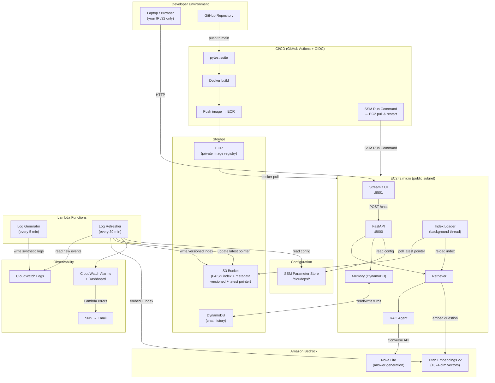

# Design Document: Cloud Ops Copilot

## Overview

Cloud Ops Copilot is a Retrieval-Augmented Generation (RAG) chat assistant that answers natural language questions about AWS CloudWatch logs. A developer asks something like "Why did the checkout Lambda fail at 2 PM?" and the system retrieves the most relevant log chunks, passes them to an Amazon Bedrock language model, and returns a grounded, cited answer.

The system runs entirely on AWS free-tier-eligible and credit-covered services. It is designed as a single-developer portfolio project with a 14–15 day build window and a fixed teardown date.

### Key Design Decisions

1. **Bedrock Titan Embeddings v2 for all vectors** — avoids PyTorch, keeps the EC2 t3.micro memory-safe, and keeps Lambda package sizes small. Vectors are produced at 1024 dimensions with the model's built-in L2 normalization flag enabled.

2. **FAISS IndexFlatIP over normalized vectors** — when every vector has unit norm, inner product equals cosine similarity. This is exact (not approximate) search, which is appropriate for the index sizes expected (tens of thousands of chunks over 7 days of logs). Source: [FAISS MetricType docs](https://github.com/facebookresearch/faiss/wiki/MetricType-and-distances).

3. **Bedrock Converse API** — a unified, model-agnostic interface for Nova Micro, Nova Lite, and Nova 2 Lite. Swapping the model ID in SSM Parameter Store changes the model without touching source code. Source: [AWS Converse API docs](https://docs.aws.amazon.com/nova/latest/userguide/using-converse-api.html).

4. **Incremental, versioned index** — the Log Refresher Lambda reads only new log events since the last checkpoint, appends new vectors to a copy of the current index, writes the updated index under a versioned S3 prefix, and atomically updates a "latest pointer" file. The running application polls this pointer and hot-reloads without a process restart.

5. **Default VPC, public subnet, no NAT** — the EC2 security group restricts ports 8000 and 8501 to the developer's `/32` CIDR. Shell access uses SSM Session Manager exclusively (port 22 is closed).

6. **Parameter Store, not Secrets Manager** — all IAM roles replace API keys, so no credentials need to be stored. Non-secret config (model IDs, bucket name, region) lives in SSM under `/cloudops/`.

7. **Everything defined in CDK** — a single `cdk deploy` provisions the entire stack; `cdk destroy` removes all billable resources.

---

## Architecture

### System Diagram



### Component Interaction Flow (Chat Request)

```
Browser  →  Streamlit (ui/app.py)
                ↓  POST /chat {session_id, question}
           FastAPI (api/server.py)
                ↓  load_history(session_id)
           Memory  ←→  DynamoDB
                ↓  embed(question)
           Embedder  →  Bedrock Titan v2
                ↓  search(vector, filters, k=8)
           Retriever  →  FAISS IndexFlatIP (in-memory)
                ↓  build_prompt(history, chunks, question)
           RAG_Agent  →  Bedrock Converse API (Nova Lite)
                ↓  parse response + cited_log_ids
           FastAPI  →  save_turn(session_id, q, a)
                ↓  Memory  →  DynamoDB
           FastAPI  ←  {answer, cited_log_ids}
        Streamlit  renders answer + citations
```

### Index Refresh Flow

```
EventBridge (every 30 min)
    → Log Refresher Lambda
        1. Read /cloudops/checkpoint from S3
        2. CloudWatchPlugin.fetch(since=checkpoint, until=now)
        3. Chunker.chunk(records)
        4. Embedder.embed_batch(chunks)  [Titan v2, batches of 25]
        5. Load current FAISS index from S3 (latest pointer)
        6. index.add(new_vectors)
        7. Write index + metadata to s3://bucket/index/v{timestamp}/
        8. Update s3://bucket/index/latest  (atomic overwrite)
        9. Write new checkpoint to S3

EC2 Application (background thread, polls every 30 s)
    1. Read s3://bucket/index/latest
    2. Compare to loaded version path
    3. If changed → download new index → swap in-memory reference
       (no process restart needed)
```

---

## Components and Interfaces

### Plugin System (`plugins/`)

```python
# plugins/base.py
from abc import ABC, abstractmethod
from datetime import datetime
from typing import Iterator
from core.models import LogRecord

class LogPlugin(ABC):
    name: str  # must be a non-empty string; enforced in __init_subclass__

    def __init_subclass__(cls, **kwargs):
        super().__init_subclass__(**kwargs)
        name = getattr(cls, "name", None)
        if not isinstance(name, str) or not name.strip():
            raise TypeError(
                f"LogPlugin subclass '{cls.__name__}' must define a non-empty 'name' attribute"
            )

    @abstractmethod
    def fetch(self, since: datetime, until: datetime) -> Iterator[LogRecord]:
        """Yield normalized LogRecord objects for the given time window."""
        ...
```

The `CloudWatchPlugin` (`plugins/cloudwatch_plugin.py`) implements `LogPlugin`. It:
- Accepts a list of log group names at construction time
- Uses `boto3` `filter_log_events` with `nextToken` pagination
- Loads and saves the checkpoint from S3
- Applies exponential-backoff retry on `ThrottlingException` and `ServiceUnavailableException`

### Core Pipeline (`core/`)

| Module | Responsibility |
|---|---|
| `models.py` | `LogRecord` dataclass; sentinel normalization |
| `chunker.py` | Group records into 300–500 token chunks; request-ID grouping first, then service+60s window |
| `embedder.py` | Bedrock Titan v2 calls; batch size ≤ 25; exponential backoff (1 s, 2 s, 4 s) |
| `vector_store.py` | FAISS IndexFlatIP; save/load to S3 with versioned path; latest-pointer update |

### Agent (`agent/`)

| Module | Responsibility |
|---|---|
| `retriever.py` | Embed question → top-8 FAISS search; apply service/level/time filters post-search |
| `rag_agent.py` | Build prompt from chunks + history; call Bedrock Converse API; parse cited IDs |
| `memory.py` | DynamoDB read/write; enforce 6-turn window by deleting oldest on overflow |

### API Server (`api/server.py`)

FastAPI application exposing:
- `GET /health` → `{"status": "ok"}`
- `POST /chat` → accepts `ChatRequest`, returns `ChatResponse`

All schemas validated with Pydantic v2.

### Streamlit UI (`ui/app.py`)

Single-page chat interface. Maintains `session_id` in `st.session_state` (UUID4 generated on first load). Calls `POST /chat` via `httpx`. Displays answer text and a collapsible "Citations" section listing the returned `cited_log_ids`.

### Lambda Functions (`lambdas/`)

| Function | Trigger | Memory | Timeout |
|---|---|---|---|
| `log_generator` | EventBridge schedule (every 5 min) | 128 MB | 60 s |
| `log_refresher` | EventBridge schedule (every 30 min) | 512 MB | 300 s |

The `log_refresher` carries FAISS as a Lambda layer (faiss-cpu, x86_64, ~90 MB zipped, well within the 250 MB unzipped limit per [AWS docs](https://repost.aws/knowledge-center/lambda-deployment-package-size)).

### CDK Application (`infra/`)

Single stack `CloudOpsCopilotStack` with the following constructs:

| Construct | Resources |
|---|---|
| `StorageConstruct` | S3 bucket (versioning on, public access blocked), DynamoDB table |
| `ContainerConstruct` | ECR repository |
| `ConfigConstruct` | SSM String parameters under `/cloudops/` |
| `ComputeConstruct` | EC2 t3.micro, instance profile, security group, EBS (encrypted) |
| `LambdaConstruct` | log_generator + log_refresher functions, FAISS layer, IAM roles |
| `ScheduleConstruct` | EventBridge rules (5 min + 30 min) |
| `ObservabilityConstruct` | CloudWatch alarms, SNS topic, CloudWatch dashboard |

---

## Data Models

### `LogRecord` (core/models.py)

```python
from dataclasses import dataclass, field
from datetime import datetime
from typing import Optional

@dataclass
class LogRecord:
    id: str
    timestamp: Optional[datetime]   # None when missing
    source: str                      # "" when missing
    service: str                     # "" when missing
    level: str                       # "" when missing
    message: str                     # "" when missing
    attributes: dict = field(default_factory=dict)  # {} when None or missing

    def __post_init__(self):
        # Sentinel normalization: None attributes → {}
        if self.attributes is None:
            self.attributes = {}
```

### `Chunk` (core/chunker.py)

```python
@dataclass
class Chunk:
    chunk_id: str          # UUID4
    text: str              # concatenated log lines, 300-500 tokens
    service: str
    level: str             # dominant level in this chunk (ERROR > WARN > INFO > DEBUG)
    time_start: datetime
    time_end: datetime
    record_ids: list[str]  # ordered list of LogRecord.id values included
```

### `VectorMetadata` (core/vector_store.py)

The JSON metadata file saved alongside the FAISS index:

```json
{
  "version": "v20261009T140000Z",
  "created_at": "2026-10-09T14:00:00Z",
  "chunk_count": 412,
  "chunks": [
    {
      "faiss_id": 0,
      "chunk_id": "3f2a...",
      "text": "2026-10-09T14:00:00Z ERROR checkout-lambda ...",
      "service": "checkout-lambda",
      "level": "ERROR",
      "time_start": "2026-10-09T13:58:00Z",
      "time_end": "2026-10-09T14:00:15Z",
      "record_ids": ["checkout-001", "checkout-002"]
    }
  ]
}
```

The `faiss_id` (integer position in the FAISS index) is the key that ties a search result back to its chunk metadata. They must remain in sync: vector at position `i` always corresponds to `chunks[i]`.

### API Schemas (api/server.py)

```python
from pydantic import BaseModel, Field
from typing import List

class ChatRequest(BaseModel):
    session_id: str = Field(min_length=1, max_length=128)
    question: str = Field(min_length=1, max_length=1000)

class ChatResponse(BaseModel):
    answer: str
    cited_log_ids: List[str] = Field(max_length=20)
    warning: str | None = None     # set when DynamoDB write fails

class HealthResponse(BaseModel):
    status: str  # always "ok"
```

### DynamoDB Schema

**Table name:** `cloudops-chat-history`
**Billing:** on-demand (PAY_PER_REQUEST)

| Attribute | Type | Role |
|---|---|---|
| `session_id` | String | Partition key |
| `turn_index` | Number | Sort key (0-based, monotonically increasing) |
| `question` | String | User message |
| `answer` | String | Assistant response |
| `timestamp` | String | ISO 8601 UTC |

The Memory component reads all items for a `session_id`, sorted by `turn_index`. When adding a new turn would exceed 6, it deletes `turn_index = 0` (the oldest), then re-indexes remaining turns, and appends the new one.

Alternatively (simpler): store turns as a single JSON attribute per session — but the per-item approach is chosen to allow atomic deletes without read-modify-write contention. See error-handling section for unavailability handling.

### SSM Parameters

All parameters are `StringParameter` type (not SecureString — IAM roles replace secrets):

| Path | Value example |
|---|---|
| `/cloudops/bedrock/model-id` | `amazon.nova-lite-v1:0` |
| `/cloudops/bedrock/embedding-model-id` | `amazon.titan-embed-text-v2:0` |
| `/cloudops/bedrock/region` | `us-east-1` |
| `/cloudops/s3/bucket-name` | `cloudops-copilot-index-abc123` |
| `/cloudops/s3/index-prefix` | `index/` |
| `/cloudops/dynamodb/table-name` | `cloudops-chat-history` |
| `/cloudops/log-groups` | `["cloudops-copilot-logs"]` (JSON array) |

### S3 Layout

```
s3://cloudops-copilot-index-{suffix}/
  index/
    latest                          ← contains "index/v20261009T140000Z"
    v20261009T140000Z/
      faiss.index                   ← binary FAISS index
      metadata.json                 ← VectorMetadata JSON
    v20261009T143000Z/
      faiss.index
      metadata.json
  checkpoints/
    cloudops-copilot-logs.json      ← {"last_timestamp": "2026-10-09T14:30:00Z"}
```

---

## Correctness Properties

*A property is a characteristic or behavior that should hold true across all valid executions of a system — essentially, a formal statement about what the system should do. Properties serve as the bridge between human-readable specifications and machine-verifiable correctness guarantees.*

### Property 1: LogRecord Normalization Produces Valid Sentinels

*For any* raw log event dictionary — including those missing optional fields, containing `None` values for string fields, or having `attributes` set to `None` — normalizing it into a `LogRecord` shall produce an object where: `attributes` is always a `dict` (never `None`), `timestamp` is either a valid `datetime` object or `None`, and every string field (`id`, `source`, `service`, `level`, `message`) is a non-`None` `str` (the empty string `""` when the field was absent or `None`).

**Validates: Requirements 3.4, 3.5, 3.7**

---

### Property 2: Chunker Produces Chunks Within Token Bounds

*For any* non-empty list of `LogRecord` objects, every `Chunk` produced by the `Chunker` shall contain between 300 and 500 tokens inclusive (using the 4-characters-per-token approximation), except when a single `LogRecord`'s text alone exceeds 500 tokens — in which case that record occupies its own minimum-size chunk and the 300-token lower bound is waived only for that record.

**Validates: Requirements 5.1, 5.2, 5.3**

---

### Property 3: Deduplication Is Idempotent and Produces Unique IDs

*For any* list of `LogRecord` objects — including lists with no duplicates, all duplicates, or arbitrary mixed orderings — applying the deduplication step twice shall produce the same result as applying it once, and the output list shall contain no two records sharing the same `id` field.

**Validates: Requirement 5.5**

---

### Property 4: Vector Store Round-Trip Preserves Query Results

*For any* valid collection of `Chunk` objects that have been embedded into normalized float vectors, saving the FAISS index and metadata file to S3 and then reloading them shall produce a store that, when queried with any fixed unit-norm vector, returns the same top-5 `chunk_id` values in the same rank order as a query against the pre-save store.

**Validates: Requirement 5.13**

---

### Property 5: Retrieval Filters Are Sound

*For any* query vector and any combination of non-`None` filter values (service name, severity level, time range), every chunk returned by the `Retriever` shall satisfy all active filter predicates: the chunk's `service` field matches the service filter (case-insensitive exact comparison), the chunk's `level` matches the level filter (case-insensitive), and the chunk's `[time_start, time_end]` interval overlaps the specified time range (including single-timestamp chunks that fall within the interval).

**Validates: Requirements 6.2, 6.3, 6.4**

---

### Property 6: Embedding Batching Preserves Completeness

*For any* list of chunks of arbitrary length, the `Embedder` shall never submit a single Bedrock API call containing more than 25 chunks, and the total count of vectors returned across all calls shall equal the total count of input chunks — no chunk is silently dropped or duplicated across batch boundaries.

**Validates: Requirement 5.8**

---

### Property 7: Session Memory Retains Only the Most Recent Six Turns

*For any* session with N prior turns (N ≥ 0), after the `Memory` component appends one new turn, the session shall contain exactly `min(N + 1, 6)` turns, and the retained turns shall be the chronologically most recent ones in ascending order.

**Validates: Requirement 8.6**

---

### Property 8: No Fabricated Citations When Evidence Is Absent

*For any* question for which the similarity score of every retrieved chunk falls below 0.5, the `RAG_Agent` shall return a response containing no log ID strings from the index, and the `cited_log_ids` list in the API response shall be empty.

**Validates: Requirements 6.7, 7.6**

---

### Property 9: CloudWatch Pagination Drops No Records

*For any* CloudWatch log group and any time window where the API returns N pages of M events each, the `CloudWatchPlugin.fetch()` method shall yield exactly N × M `LogRecord` objects — one per event — without skipping pages or events.

**Validates: Requirement 4.2**

---

### Property 10: Checkpoint Resume Excludes Already-Processed Events

*For any* checkpoint timestamp T and any list of log events with varying timestamps, the `CloudWatchPlugin` when given checkpoint T shall yield only events whose timestamp is strictly greater than T, regardless of the absolute value of T or the distribution of event timestamps.

**Validates: Requirement 4.3**

---

### Property 11: API Validates Request Field Lengths

*For any* `POST /chat` request where `session_id` has length outside `[1, 128]` or `question` has length outside `[1, 1000]`, the API shall return HTTP 422 with a validation error body identifying the offending field — and for any request where both fields are within bounds, the API shall return HTTP 200 with a response body conforming to the `ChatResponse` schema.

**Validates: Requirements 8.3, 8.4**

---

### Property 12: Recall@8 Score Is Correctly Computed

*For any* collection of evaluation question results (each with a set of retrieved log IDs and a set of expected log IDs), the recall@8 value computed by the `Evaluation_Runner` shall equal the proportion of questions for which the intersection of retrieved IDs and expected IDs is non-empty, and shall always be a float in the range `[0.0, 1.0]`.

**Validates: Requirement 7.4**

---

## Error Handling

### Embedding Throttling (Requirement 5.7)

The `Embedder` uses a fixed exponential backoff schedule: wait 1 s after the first failure, 2 s after the second, 4 s after the third. If all three retries fail, the exception is re-raised to the caller (the Log Refresher Lambda or the API request handler). The Lambda runtime will record the error in CloudWatch, triggering the alarm defined in Requirement 12.1.

### CloudWatch API Errors During Fetch (Requirement 4.7)

If `filter_log_events` returns an error for a log group, the plugin:
1. Logs the error with the log group name and AWS error code to CloudWatch Logs.
2. Leaves the existing checkpoint unchanged for that log group.
3. Returns zero records for that group.
4. Does not affect processing of other log groups.

### S3 Write Failure During Refresh (Requirement 11.9)

If any S3 write fails during the refresh cycle (index, metadata, latest pointer, or checkpoint), the Lambda:
1. Aborts immediately.
2. Leaves all S3 objects in their pre-run state (the latest-pointer file is only updated after the index write succeeds, so partial writes do not corrupt the pointer).
3. Returns a non-zero exit code, which surfaces as a Lambda error and triggers the CloudWatch alarm.

The write order is intentionally sequenced: `faiss.index` → `metadata.json` → `latest` pointer → checkpoint. Only when all four succeed is the checkpoint advanced. If the process dies between pointer update and checkpoint write, the next run will re-process a small window of already-indexed events; deduplication in the chunker prevents duplicate chunk ingestion.

### DynamoDB Unavailability (Requirements 8.9, 8.10)

- **Read failure** (before generating a response): return HTTP 503 `{"detail": "Session history temporarily unavailable"}`.
- **Write failure** (after generating a response): return HTTP 200 with the answer and `"warning": "Session history could not be saved"`. The answer is not withheld.

### Bedrock Converse API Errors (Requirement 6.8)

Catch `ClientError` from boto3. Return HTTP 500 with `{"detail": "Answer generation failed. Please try again."}`. Never include the AWS error code, request ID, or stack trace in the response body. Log full error details to CloudWatch Logs.

### Plugin Missing `name` Attribute (Requirement 3.3)

Enforced at class definition time via `__init_subclass__`. The `TypeError` is raised before any instance is created, so misconfigured plugins fail at import time rather than at runtime.

---

## Testing Strategy

### Dual Approach

Both unit/example-based tests and property-based tests are used. Unit tests verify specific examples and error conditions. Property tests verify universal invariants across thousands of generated inputs.

### Property-Based Testing with Hypothesis

[Hypothesis](https://hypothesis.readthedocs.io/) is the property-based testing library used throughout this project. It integrates natively with pytest and generates inputs automatically, including edge cases (empty strings, Unicode, boundary values, `None`).

Each property test is configured with `@settings(max_examples=100)` (the minimum for production confidence) and tagged with a comment referencing the design property it validates:

```python
# Feature: cloud-ops-copilot, Property 3: Deduplication Is Idempotent
@given(records=st.lists(log_record_strategy(), max_size=50))
@settings(max_examples=100)
def test_deduplication_idempotent(records):
    once = deduplicate(records)
    twice = deduplicate(once)
    assert once == twice
    ids = [r.id for r in once]
    assert len(ids) == len(set(ids))
```

### Unit Test Coverage

| Area | Test file | Approach |
|---|---|---|
| LogRecord normalization | `tests/test_models.py` | Hypothesis (Property 1) |
| Chunker token bounds | `tests/test_chunker.py` | Hypothesis (Property 2) |
| Deduplication idempotence | `tests/test_chunker.py` | Hypothesis (Property 3) |
| Vector store round-trip | `tests/test_vector_store.py` | Hypothesis (Property 4); mocked S3 with moto |
| Retrieval filter soundness | `tests/test_retriever.py` | Hypothesis (Property 5); in-memory FAISS |
| Embedder batch completeness | `tests/test_embedder.py` | Hypothesis (Property 6); mocked Bedrock |
| Session memory truncation | `tests/test_memory.py` | Hypothesis (Property 7); mocked DynamoDB with moto |
| RAG no-fabrication | `tests/test_rag_agent.py` | Hypothesis (Property 8); mocked Bedrock |
| CloudWatch pagination | `tests/test_cloudwatch_plugin.py` | Hypothesis (Property 9); moto CloudWatch Logs |
| Checkpoint resume | `tests/test_cloudwatch_plugin.py` | Hypothesis (Property 10); moto |
| API field length validation | `tests/test_api.py` | Hypothesis (Property 11); FastAPI TestClient |
| Recall@8 computation | `tests/test_eval.py` | Hypothesis (Property 12); pure function, no AWS mocks |
| Plugin name enforcement | `tests/test_models.py` | Example-based; 3 cases (missing, empty, None) |
| Embedder retry logic | `tests/test_embedder.py` | Example-based; mock throttle N times then succeed |
| Log generator invocation | `tests/test_lambdas.py` | Example-based; invoke handler, assert ≥ 10 records, ERROR + INFO present |
| API DynamoDB unavailability | `tests/test_api.py` | Example-based; mock DynamoDB to raise exception |
| CDK stack synthesis | `tests/test_infra.py` | CDK `assertions` snapshot; `cdk synth` exit code |

### Integration Tests (Requirement 9.6)

Using FastAPI's `TestClient` with mocked AWS dependencies (via `moto`):
- `GET /health` returns 200 and `{"status": "ok"}`
- `POST /chat` with valid body returns a response matching `ChatResponse` schema
- `POST /chat` with missing `session_id` returns HTTP 422
- `POST /chat` with `question` exceeding 1000 characters returns HTTP 422

### Property Test Configuration

```python
# conftest.py / pyproject.toml
[tool.pytest.ini_options]
addopts = "--tb=short"

# Each property test uses:
from hypothesis import given, settings, HealthCheck
@settings(max_examples=100, suppress_health_check=[HealthCheck.too_slow])
```

### What Is NOT Property-Tested

The following areas use example-based or integration tests only, because PBT would not add value:

- **CDK stack synthesis** (`cdk synth`) — declarative IaC, not a function with input/output logic. Uses `aws-cdk-lib.assertions` snapshot tests.
- **Streamlit UI rendering** — visual layout; tested manually and via integration with the API.
- **CloudWatch alarm configuration** — smoke test: single execution to verify the alarm exists and fires.
- **SNS email delivery** — one forced-failure integration test (Requirement 12.4).
- **End-to-end pipeline** (Requirement 15.1) — single-run integration test covering log generation → ingestion → indexing → retrieval → answer.
